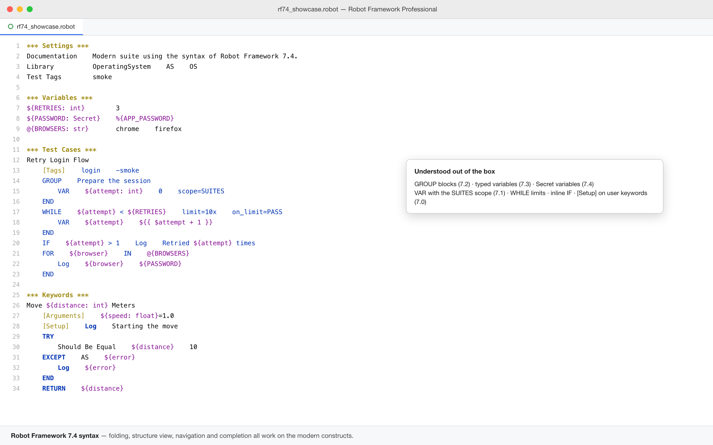
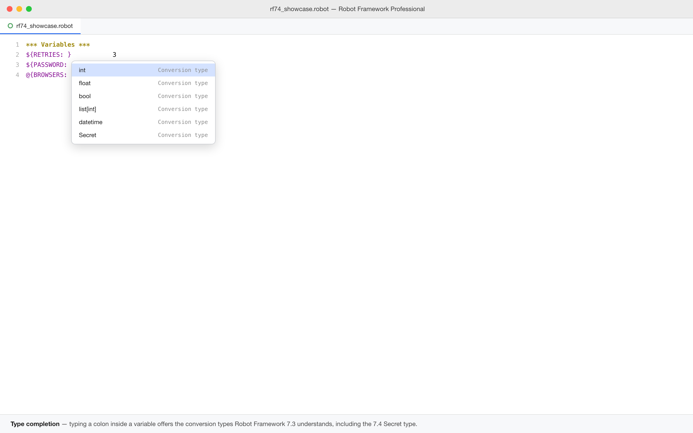
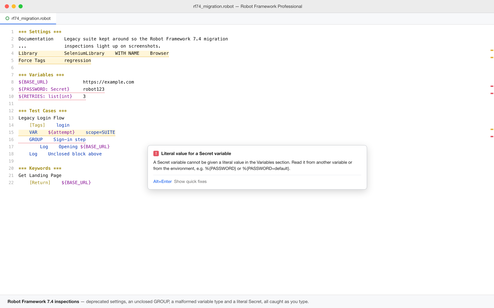
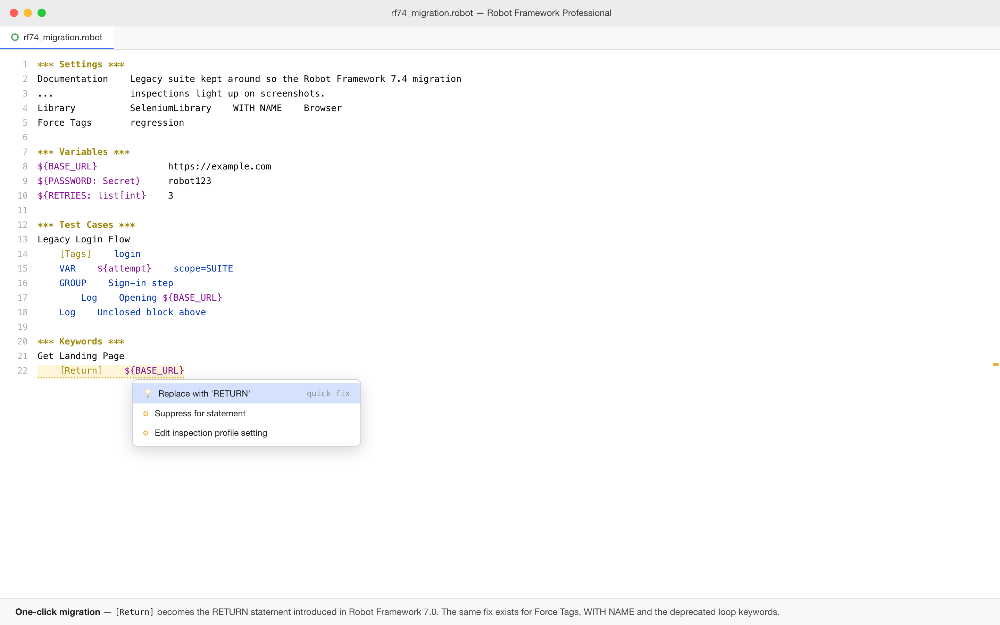
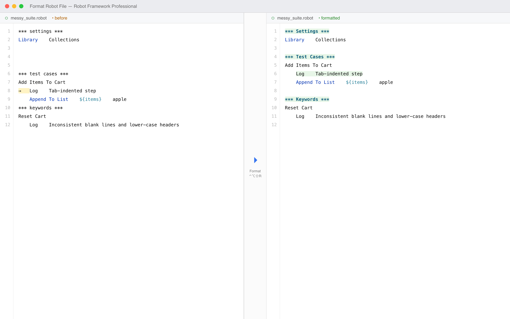
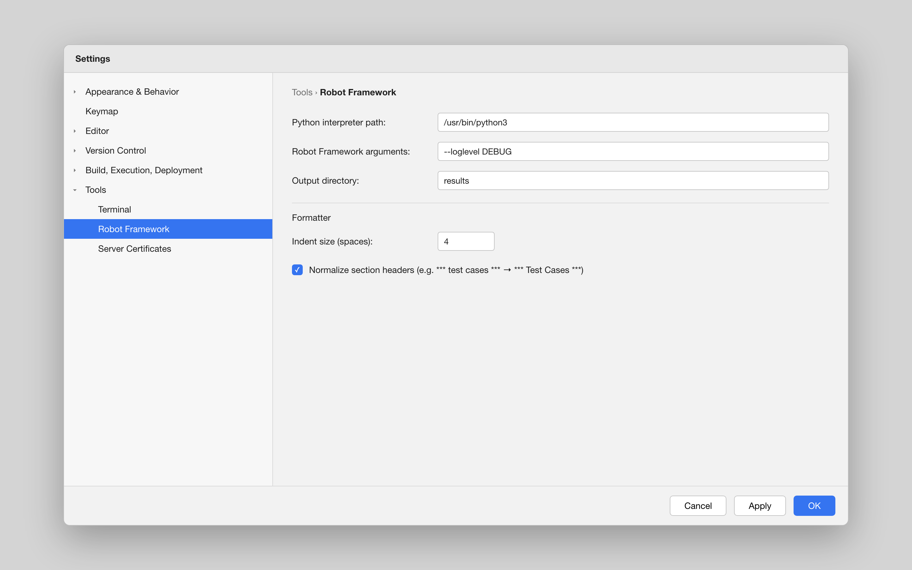

# Robot Framework

Full-featured Robot Framework language support for JetBrains IDEs with syntax highlighting, code completion, navigation, inspections, test execution, and debugging capabilities.

Tracks the syntax of **Robot Framework 7.4**.

## Robot Framework 7.x syntax

- **`GROUP` blocks** (RF 7.2) — highlighting, folding (`GROUP...END`), completion, `group` live template, and `END` matching
- **Variable type conversion** (RF 7.3) — `${amount: int}`, `@{ids: list[int]}`, `&{m: dict[str, int]}`, unions and `Literal["UP", "DOWN"]` are highlighted with a dedicated colour, completed after the colon, and validated; `typedvar` live template
- **Secret variables** (RF 7.4) — completion, `secret` live template, and an inspection that rejects literal secrets in `*** Variables ***`
- **`VAR` statement** (RF 7.0, `SUITES` scope in 7.1) — scope and `separator=` completion, `var` live template, and a warning for a non-local `VAR` without a value (deprecated in RF 7.4)
- **`WHILE` limits** — completion for `limit=`, `on_limit=`, `on_limit_message=`; `while` live template
- **Inline `IF`**, **`[Setup]` on user keywords** and **`-tag` removal** (RF 7.0) are understood by the editor and the inspections
- **`*** Tasks ***`** behaves like Test Cases; **`*** Comments ***`** content is greyed out as ignored data
- **Migration fixes** — `[Return]` → `RETURN`, `Force Tags` → `Test Tags`, `WITH NAME` → `AS`, singular headers → plural, `Exit For Loop` → `BREAK`, `Continue For Loop` → `CONTINUE`, `Return From Keyword` → `RETURN`, `FOR IN ZIP` without `mode=`, literal `-tag` in `Test Tags` → `\-tag`

## Features

- **Syntax highlighting** — full RF syntax coloring for keywords, variables (`${}`, `@{}`, `&{}`, `%{}`), variable types, section headers, control structures (IF, TRY, FOR, WHILE, GROUP), tags, and embedded arguments
- **Smart code completion** — auto-complete for RF 7.x control structures, 40+ BuiltIn library keywords, Collections & String library keywords, built-in variables, settings section keywords, conversion types, and user-defined keywords/variables
- **Go to declaration** — Ctrl+Click (Cmd+Click on Mac) navigation to keyword and variable definitions with normalized matching (handles `My Keyword`, `my_keyword`, `MyKeyword`)
- **Find references** — locate all usages of keywords and variables across your project
- **Inline documentation** — hover documentation for keywords with parameter hints and inlay providers
- **Code folding** — collapse/expand test cases, keywords, and section blocks
- **Structure view** — hierarchical overview of `.robot` file structure with PSI-based model
- **Breadcrumbs navigation** — path-based navigation in the editor
- **Annotators & inspections** — real-time detection of undefined keywords, undefined variables, duplicate keywords, missing resource files, and embedded argument validation
- **Block structure inspection** — unclosed `IF`/`FOR`/`WHILE`/`TRY`/`GROUP` and orphan `END` (inline `IF` correctly needs no `END`)
- **Test name length inspection** — warning for overly long test names
- **Empty test case inspection** — detects test cases with no steps, with an *Add `No Operation`* fix
- **Code formatter** — reformat a suite with `Ctrl+Alt+Shift+R`: canonical section headers, tabs → spaces, trimmed trailing whitespace, normalized blank lines (idempotent)
- **Quality inspections + quick fixes** — duplicate test-case names, tab separators (fix: convert to spaces), trailing whitespace (fix: remove), unresolved `TODO`/`FIXME`/`XXX` markers, and unused suite variables
- **Rename refactoring** — rename keywords with automatic propagation across files
- **Run configurations** — create and execute Robot Framework test runs directly from the IDE
- **Debug support** — debug tests with breakpoint support (Ctrl+Shift+F9)
- **Interactive REPL** — open a Robot Framework interactive console
- **Web Inspector** — visual element selection tool window for web testing
- **Live templates** — snippet support for common RF patterns
- **Customizable colors** — configurable syntax highlighting via Color Settings page

## Installation

1. **JetBrains Marketplace**: Settings → Plugins → Marketplace → Search "Robot Framework"
2. **Manual**: Download from [Releases](https://github.com/JirakJ/robot-framework-plugin/releases) → Settings → Plugins → ⚙️ → Install from disk

## Requirements

- IntelliJ IDEA 2024.2+ (build 242+)
- Any JetBrains IDE (IntelliJ, WebStorm, PyCharm, etc.)
- Robot Framework installed in your project environment

## Configuration

Settings → Tools → Robot Framework

Customize syntax highlighting colors via Settings → Editor → Color Scheme → Robot Framework.

## Usage

### Run a Test
Open a `.robot` file → right-click on a test case → **Run Test** (Ctrl+Shift+F10) or **Debug Test** (Ctrl+Shift+F9).

### Navigate to Keywords
Place your cursor on any keyword and press **Ctrl+Click** (Cmd+Click on Mac) to jump to its definition. Works across files with normalized keyword matching.

### Generate Keywords
Right-click in the editor → **Generate Keyword** to auto-generate a new keyword template.

### Format a Suite
Open a `.robot`/`.resource` file → **Robot Framework → Format Robot File** (`Ctrl+Alt+Shift+R`), or right-click → **Format Robot File**. Indent size and header normalization are configurable under Settings → Tools → Robot Framework.

## Screenshots

| Robot Framework 7.4 syntax | Conversion type completion |
| --- | --- |
|  |  |

| Inspections | One-click migration |
| --- | --- |
|  |  |

| Formatter (before / after) | Formatter settings |
| --- | --- |
|  |  |

The capture kit (sample project, renderer and per-shot guide) lives in
[`docs/screenshots`](docs/screenshots/SCREENSHOTS.md); regenerate with
`python3 docs/screenshots/src/render.py`.

### Use the Web Inspector
Menu → Robot Framework → **Open Web Inspector** to launch the visual element selection tool for identifying web elements.

## Building from Source

```bash
./gradlew buildPlugin
```

## License

Copyright © 2026 Jakub Jirák. All rights reserved.
